# markovChains
Curso: Inferencia y modelado probabilístico

# Introducción

En este proyecto, se desarrollará un modelo probabilístico para simular
el movimiento de una persona adulta mayor en el interior de una casa,
esto podría ser útil para personas con vulnerabilidades y mejorar su
autonomía

# metodología

En esta ocasión, para modelar se utilizó el lenguaje de R. El proyecto
se divide en 5 etapas

- Definición de estado físico

- Simulación de datos

- Modelo de cadena de Markov

- Inferencia de actividades +

- Simulación de Montecarlo

# Definición de estado físico

Se uso un caso básico de hogar, que cuente la sala, una recámara, un
baño y una cocina.

``` {#lst:etapa1 .r language="R" caption="Etapa 1" label="lst:etapa1"}
library(igraph)
crear_grafo<-function(habitacion,aristas,graficar=TRUE){
  g<-graph(edges=aristas,directed = TRUE);
  if(graficar){
    plot(g, vertex.size=30, vertex.color="lightblue", edge.arrow.size=0.5, 
         vertex.label.cex=1.2, main="Mapa de la vivienda")
    
  }
  return(g)
}

habitaciones<-c("Recámara","Sala","Cocina","Baño")
aristas <- c("Sala", "Cocina",
             "Sala", "Baño",
             "Sala","Sala",
             "Sala","Recámara",
             "Cocina", "Sala",
             "Cocina", "Recámara",
             "Cocina", "Cocina",
             "Cocina", "Baño",
             "Baño", "Sala",
             "Baño","Recámara",
             "Baño","Cocina",
             "Baño","Baño",
             "Recámara", "Sala",
             "Recámara","Cocina",
             "Recámara","Baño",
             "Recámara","Recámara")
crear_grafo(habitaciones,aristas)
```

<figure id="fig:grafo de dirección" data-latex-placement="h!">
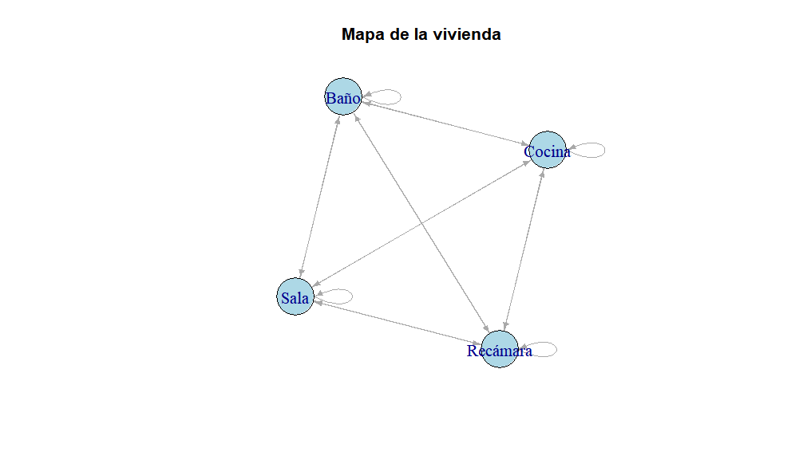
<figcaption>Caption</figcaption>
</figure>

El código de (Listing.
[\[lst:etapa1\]](#lst:etapa1){reference-type="ref"
reference="lst:etapa1"}) Muestra como generar un grafo con R. Se utiliza
una librería llamada *igraph* que permite graficar un grafo. En la
función $crear\_grafo$, se le pasan las aristas y se le indica que es un
grafo dirigido y preguntamos si queremos graficar. Finalmente retorna g,
que es un objeto del tipo graph que servirá para poder gráficar fuera de
la función. La imagen [1](#fig:grafo de dirección){reference-type="ref"
reference="fig:grafo de dirección"},representa los 4 estados posibles y
todas las direcciones posibles. Con este diseño, el adulto mayor puede
desplazarse a lo largo del hogar en cada uno de los puntos

# Etapa 2

Consiste en la creación de una matriz de transición para el grafo
generado. Dado a que no tenemos extraídos por algún sensor, es nuestra
tarea generar los datos.

``` {#lst:etapa2 .r language="R" caption="Etapa 2" label="lst:etapa2"}
matriz_transicion<-function(estados,pasos){
  secuencia<-sample(1:estados,pasos,replace=TRUE)
  frecuencias<-matrix(0,nrow=estados,ncol=estados)
  for(i in 1:(length(secuencia)-1)){
    actual<-secuencia[i]
    siguiente<-secuencia[i+1]
    frecuencias[actual,siguiente]<-frecuencias[actual,siguiente]+1
  }
  m<-frecuencias/rowSums(frecuencias)
  return(m)
}
P<-matriz_transicion(length(habitaciones),288)
```

El código presentado en la etapa 2
(listing.[\[lst:etapa2\]](#lst:etapa2){reference-type="ref"
reference="lst:etapa2"}) Genera una matriz de transición a partir de una
cantidad de estados y pasos. Los estados que tenemos son la cantidad de
habitaciones, y queremos modelarlo en 1 día cada 5 minutos. Primeramente
generamos una secuencia de forma aleatoria. Puede tomar valores del 1
hasta la cantidad de estados, siendo del tamaño de la cantidad de pasos.
Necesitaremos una matriz de frecuencia con el tamaño de estados
$P^{n \times n}$,siendo n, el tamaño de estado. En nuestro ciclo,
hacemos el recorrido de los elementos de secuencia. Y primeramente, le
pasamos a actual el i-ésimo elemento de secuencia, y siguiente será
$i+1$. Esto cumple con la propiedad de Markov, en la sigue una sucesión
de pasos. En frecuencias se añadirá la cantidad de veces que un elemento
se añadió, por ejemplo, el elemento 1,1, ¿Cuantas veces se añadió? Con
esto en mente, podemos calcular las probabilidades, dividiendo cada
elemento entre la suma.Se retorna la matriz de transición

En la línea 12, podemos recuperar la matriz de transición dado la
cantidad de habitaciones y la cantidad de pasos

# Etapa 3

Consistirá en crear el modelo de markov. El modelo de markov está
determinado por 

$$p(\mathbf{x}_1,\dots,\mathbf{x}_n)=p(\mathbf{x}_1)\prod^{N}_{n=2}p(\mathbf{x}_n|\mathbf{x}_{n-1})$$

La ecuación (Eq.1
[\[eq:cadena_markov\]](#eq:cadena_markov){reference-type="ref"
reference="eq:cadena_markov"}) describe como es el modelo de markov, en
pocas palabras, un modelo de Markov nos puede decir que probabilidad
existe que un estado pueda pasar a otro. Las cadenas de markov entran
como anillo al dedo, ya que podemos definir cada una de las habitaciones
como estados posibles, y queremos intentar saber si el señor irá a otra
habitación o no

## Generar la simulación en un n cantidad de días

``` {#lst:etapa3 .r language="R" caption="Etapa 2" label="lst:etapa3"}
trayectoria<-function(pasos,estado_inicial,matriz){
  transicion<-numeric(pasos)
  transicion[1]<-estado_inicial
  for (i in 2:pasos){
    transicion[i]<-sample(1:nrow(matriz),size=1,prob = matriz[transicion[i-1], ])
  }
  return(transicion)
}
simulacion_ndias<-function(dias,P,pasos,hab,plotit=TRUE){
  ndias<-matrix(0,nrow=dias,ncol=pasos)
  ndias[1,]<-trayectoria(pasos,1,P)
  for (i in 2:dias){
    ndias[i,]<-trayectoria(pasos,ndias[i-1,pasos],P)
  }  
  probabilidades<-apply(ndias,2,function(col){
    prop.table(table(factor(col,levels=1:length(hab))))
  })
  if(plotit){
    graficar(probabilidades=probabilidades,ndias=ndias,hab=hab)
  }
  return(probabilidades);
}
graficar<-function(barl=TRUE,sequencePLot=TRUE,probabilidades,ndias,hab=hab){
  if(sequencePLot){
    matplot(t(probabilidades), type = "l", col = c("red", "blue", "green", "purple"),
            lty = 1, lwd = 2, xlab = "Tiempo (en pasos de 5 minutos)", ylab = "Probabilidad",
            main = "Probabilidad de estar en cada habitación a lo largo del día")
    legend("topright", legend = hab,
           col = c("red", "blue", "green", "purple"), lty = 1, lwd = 2)
  }
  if(barl){
    hist(ndias[, nrow(probabilidades)], breaks = 0.5 + 0:4, xaxt = "n", col = "skyblue",
         main = "Distribución del estado final del día", xlab = "Habitación")
    axis(1, at = 1:4, labels = c("Sala", "Cocina", "Baño", "Recámara"))
  }
}
probabilidades<-simulacion_ndias(100,P,288,habitaciones)
```

El código (list [\[lst:etapa3\]](#lst:etapa3){reference-type="ref"
reference="lst:etapa3"}), tiene 3 secciones principales; la trayectoria,
simulación n días y gráficas. Para la función trayectoria, debemos de
pasarle una cantidad de pasos, el estado inicial y la matriz de
transición. Creamos un vector denominado transicion, que contendrá los
números de estados, es de tamaño pasos $T^{pasos \times 1}$. En el
primer elemento de transición, irá el el estado inicial. Como ya tenemos
el primer elemento, empezamos desde 2 hasta lo pasos. En el vector
transición, cada iésimo elemento, contendrá un número aleatorio de los
estados ,(definido por 1:nrow(matriz)),de tamaño 1(un escalar, es decir,
un único número) y una probabilidad, que será dada por la matriz de
probabilidad dado el estado anterior, (ya que transición posee un primer
elemento, tomará una fila y esa fila posee un vector de probabilidad).
La matriz de probabilidad de una cadena de markov, posee i filas y j
columnas. Si tienes una cantidad de estados $E$, entonces i,j irán de
$[1,\dots,E]$. La matriz de transición también es una matriz
estocástica, porque en cada fila, la suma de sus elementos, da siempre
1, esto se define como un vector por estado $\pi_i ^{1 \times E}$.
Entonces, en la programación utilizamos este vector del estado anterior
para predecir el estado actual. Al finalizar, se retorna ese vector.

La función de transición solamente contendrá el recorrido de los estados
en un día, para simular en varios días, la función simulacion_ndias la
realizará. Esta función necesita el número de días, la matriz de
transición, las habitaciones y un valor de verdadero falso, para indicar
si se quiere graficar o no.

Primero, se define una matriz que tendrá la cantidad de días de
simulación en sus filas y en sus columnas los pasos. En el día 1 se hace
una trayectoria, y se utiliza la función de trayectoria para calcularlo.
Después se realiza el recorrido del siguiente día en adelante, generando
varias trayectorias, siendo el estado inicial el último elemento del día
anterior,(es decir, lo último que hizo antes que se acabara el día).
Después, vamos a calcular la proporción de actividades por día. entonces
la función apply, permite aplicarle una función lambda, a una matriz, se
indica con el 2 que va por columnas. La función lambda contendrá una
función llamada prop.table() que necesita un valor del tipo table, y
dentro de table hacemos un factor, que lo que permite es generar un
vector, en el que estarán contenidos valores numéricos (en este caso
col) y los nombres de las etiquetas asociados a esas columnas (la
sección de labels). De esta manera, se genera una tabla y a su vez,
podemos calcular la proporción de la tabla por columna. Retornando la
matriz de proporción de número de días y de secciones de simulación.
Después está la función graficar, que se le pasan dos valores, para
identificar cual gráfica mostrar. las probabilidades y el número de
días. La primera gráfica despliega una serie de tiempo, de como
evoluciona la proporción por habitación en cada día. La segunda gráfica
es un histograma, muestra la frecuencia con la que el señor acaba el
día.

Finalmente en la línea 37, podemos llamar a la simulación, con 100 días,
una matriz de transición, cada 5 minutos y con la cantidad de
habitaciones que en la etapa 1 se definieron.

Dada la siguiente matriz generada en la etapa 2. 

$$P=\begin{bmatrix}
    0.3387 &0.2097& 0.2580&0.1935 \\
    0.12 & 0.32 &0.32 & 0.24 \\
    0.1973 & 0.2631 &0.1973 & 0.3421 \\
    0.2297 & 0.2432 & 0.2837 & 0.2432
\end{bmatrix}$$

Y con una simulación de 100 días cada 5 minutos se
obtuvieron los resultados de las gráficas (fig
[2](#fig:evolucion){reference-type="ref" reference="fig:evolucion"}, fig
[3](#fig:histo){reference-type="ref" reference="fig:histo"}) La figura
[2](#fig:evolucion){reference-type="ref" reference="fig:evolucion"} nos
describe, que el señor tuvo una mayor proporción de estar en la sala en
el 100 (es decir, si tomamos en cuenta que se empieza desde las 12:00
AM, el paso 100 son 500 minutos es decir a las 8:20 de la mañana) suele
estar más en la sala, mientras que más tarde, podemos encontrar que el
señor suele ir mucho a la cocina. El señor suele ir más a su recamará
ente las 4 de la tarde. La figura [3](#fig:histo){reference-type="ref"
reference="fig:histo"} afirma lo anteriormente mencionado, ya que el
histograma representa en el último momento del día, la habitación en
donde estará es en la cocina,seguido por el baño y la recámara

<figure id="fig:graficos" data-latex-placement="h!">
<figure id="fig:evolucion">
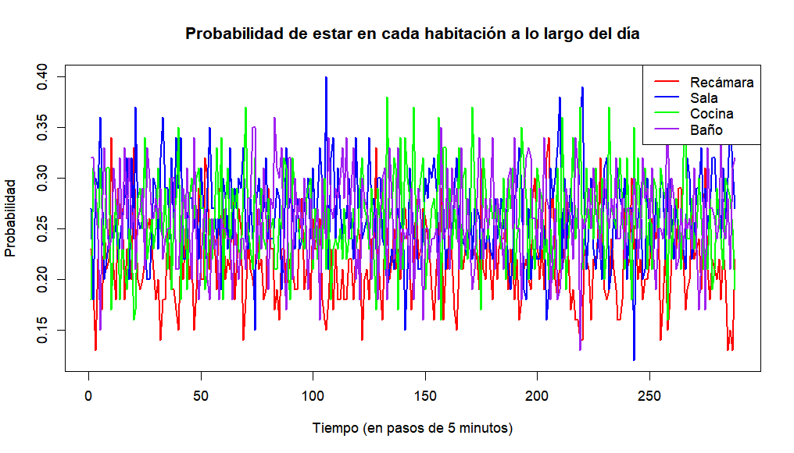
<figcaption>Evolución de las habitaciones recorridas</figcaption>
</figure>
<figure id="fig:histo">
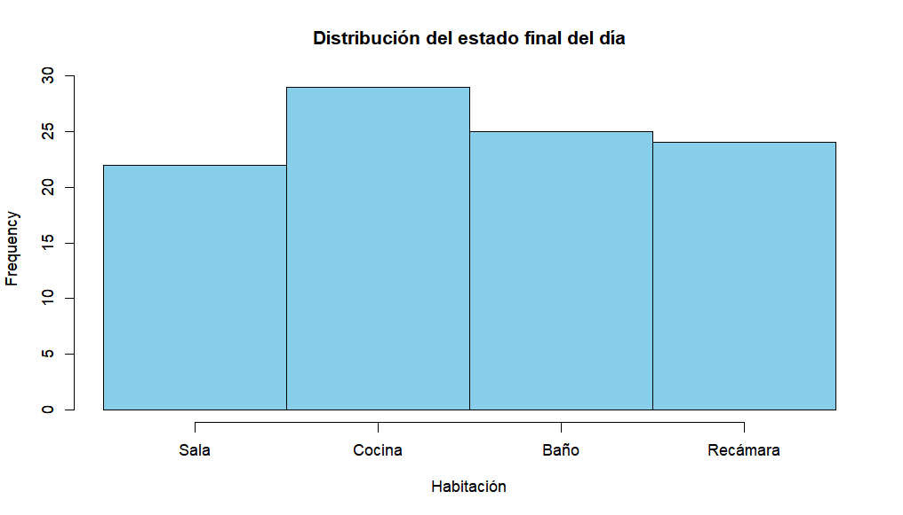
<figcaption>Histograma de los pasos que recorrió el señor</figcaption>
</figure>
<figcaption>Simulaciones con cadenas de Markov de primer
orden</figcaption>
</figure>

## Encontrar estados recurrentes

Esto es únicamente con el fin de encontrar cuales son estados
recurrentes dado la definición 

$$\sum^{\infty}_{n=1}p_{jj}<\infty$$

``` {#lst:etapa3b .r language="R" caption="Etapa 2" label="lst:etapa3b"}
identificar_recurrentes_aprox <- function(P, max_iter = 100, nombres_estados = NULL) {
  estados <- nrow(P) 
  recurrentes <- rep(FALSE, estados)
  acc <- diag(estados)
  for (i in 1:max_iter) {
    acc <- acc %*% P
    recurrentes <- recurrentes | (diag(acc) > 0)
  }
  
  if (!is.null(nombres_estados)) {
    return(nombres_estados[which(recurrentes)])
  } else {
    return(which(recurrentes))
  }
}
recur<-identificar_recurrentes_aprox(P,100,habitaciones)
```

El código que se encuentra (list
[\[lst:etapa3b\]](#lst:etapa3b){reference-type="ref"
reference="lst:etapa3b"}), requiere la matriz de transición, una
cantidad de iteraciones y los nombres de los estados. Primero identifica
la cantidad de estados a traves de la matriz. En recurrentes, crea un
vector de tamaño estados con el valor de falso. Acc, contiene la
diagonal principal de tamaño de estados. Después, hace multiplicaciones
hasta un max iter, y recurrentes se actualizará dado a si la diagonal
principal es mayor a 0. Si los nombres de los estados fueron
proporcionados arrojará un vector con los estados que si son
recurrentes, sino, solamente los números.

Finalmente, la gráfica [2](#fig:evolucion){reference-type="ref"
reference="fig:evolucion"} nos indicará de forma visual la evolución de
probabilidades por habitación durante un día.

# Inferencia de actividades

En este caso, supongase que se tiene la habitación recámara,en ella, el
señor puede realizar variedad de actividades, tales como leer, escribir,
dormir, etcétera. Entonces, para poder modelar las actividades, se
aplica un modelo de cadenas de markov ocultas, (HMM). Se puede proponer
una forma jerarquica, que implica que cada cadena observable tiene un
cadena oculta y que se activa al visitarla. O la forma plana, que es
introduce la matriz de transición con cada una de las
actividades-habitaciones y tenemos una matriz de emisión que indica la
pertenencia de actividad, habitación.

Para ejecutar este modelo, se aplican los siguientes pasos

- Crear estados

- crear matriz de transición

- crear una distribución pi

- Simular HMM

- viterbi

``` {#lst:etapa4 .r language="R" caption="Etapa 2" label="lst:etapa4"}
crear_estados <- function(actividades_por_habitacion) {
  estados <- unlist(lapply(names(actividades_por_habitacion), function(hab) {
    paste(actividades_por_habitacion[[hab]], "en", hab)
  }))
  return(estados)
}


crear_matriz_emision <- function(estados_actividades, habitaciones) {
  n_estados <- length(estados_actividades)
  n_obs <- length(habitaciones)
  
  B <- matrix(0, nrow = n_estados, ncol = n_obs)
  
  for (i in 1:n_estados) {
    actividad_hab <- strsplit(estados_actividades[i], " en ")[[1]][2]
    B[i,which(habitaciones==actividad_hab)]<-1
  }
  return(B)
}

crear_pi_inicial <- function(n_estados) {
  rep(1/n_estados, n_estados)
}


simular_HMM <- function(pasos, A, B, pi) {
  n_estados <- nrow(A)
  n_obs <- ncol(B)
  estados_ocultos <- numeric(pasos)
  observaciones <- numeric(pasos)

  estados_ocultos[1] <- sample(1:n_estados, size=1, prob=pi)
  observaciones[1] <- sample(1:n_obs, size=1, prob=B[estados_ocultos[1], ])
  
  for (t in 2:pasos) {
    estados_ocultos[t] <- sample(1:n_estados, size=1, prob=A[estados_ocultos[t-1], ])
    observaciones[t] <- sample(1:n_obs, size=1, prob=B[estados_ocultos[t], ])
  }
  
  return(list(estados_ocultos=estados_ocultos, observaciones=observaciones))
}


viterbi <- function(obs, A, B, pi) {
  n_obs <- length(obs)
  n_states <- nrow(A)
  
  T1 <- matrix(0, nrow=n_states, ncol=n_obs)
  T2 <- matrix(0, nrow=n_states, ncol=n_obs)
  
  for (s in 1:n_states) {
    T1[s, 1] <- pi[s] * B[s, obs[1]]
  }
  
  for (t in 2:n_obs) {
    for (s in 1:n_states) {
      prob_vec <- T1[, t-1] * A[, s] * B[s, obs[t]]
      T1[s, t] <- max(prob_vec)
      T2[s, t] <- which.max(prob_vec)
    }
  }
  
  Z <- numeric(n_obs)
  Z[n_obs] <- which.max(T1[, n_obs])
  
  for (t in (n_obs-1):1) {
    Z[t] <- T2[Z[t+1], t+1]
  }
  
  return(Z)
}
```

En el código [\[lst:etapa4\]](#lst:etapa4){reference-type="ref"
reference="lst:etapa4"} se observa cada uno de los pasos. A la función
crear estados, se le pasa el conjunto de actividades por habitación,
siendo una lista. De tal manera que se desenpaqueta y se le aplica una
función lambda. Se extraen las claves de la lista y por habitación se
concatena la actividad con la cadena Retorna un arreglo donde estarán
las concatenaciones de estados con actividades La función crear matriz
emision, requiere el arreglo donde están las actividades por estado y
las habitaciones Se obtiene la cantidad total de estados y de estados
observables,(habitaciones) Se genera una matriz con la cantidad de
estados por la cantidad de estados observables. Después, dentro del for
recorremos la cantidad de espacios totales y dividimos cada string,
obteniendo el cuarto , de tal manera que en la iésima fila, si las
habitaciones coinciden con la habitacion dividida, se le añade 1. Al
final retornamos B. Esta matriz es útil ya que es el enlace directo
entre los estados observables y los ocultos.

La función crear pi inicial, es una distribución de probabilidad
uniforme, solamente para generar la matriz de transición de nuestro
markov oculto.

simular_HMM nos recordará mucho a como se hacia la matriz de transición
para una cadena de primer orden, obtenemos la matriz de A,(que es una
matriz de transición), la matriz de emisión y la distribución de
probabilidad. Se extrae el número de estados y de columnas, se generan
vectores de estados ocultos y de observaciones de tamaño de pasos. Se
inicializa el estado oculto por medio de un número aleatorio entre 1 y
la cantidad total de estados con un probabilidad, que será la
distribución pi. En observaciones realiza lo mismo pero entre el 1 y el
número de observaciones totales, sin embargo, la probabilidad se
encuentra a través de la matriz de emisión, en la fila del estado que
encuentre primero el estado oculto. Se hace el recorrido a partir del
segundo paso y por cada i-ésimo estado, tomo un valor aleatorio dentro
de los estado, en base a la fila encontrada del estado anterior, por su
parte las observaciones la probabilidad la basa del estado oculto actual
Se devuelve una lista con dos vectores Si se observa, es la misma
metodología que con trayectoria. Sin embargo, podemos hacer este proceso
pero de una forma más determinista. La función anterior genera
secuencias a través de muestra aleatorias, pero viterbi determina la
secuencia a partir de una matriz de transición y un secuencia observada.
Se obtiene el vector de observaciones, luego la matriz A,B y pi. se
generarán dos matriz, T1,T2 que serán del tamaño estados por
observación. Se recorrer el número de estados y en T1, se añade la
multiplicación del valor i-ésimo en pi por la matriz de emisión en la
fila i-ésima para la primera observación. Recorremos las observaciones y
en cada observación todos los estados. Se calcula un vector de
probabilidad dado el estado anterior de t1 por el estado actual en la
matriz de transición A por la matriz de emisión en el i-ésimo elemento
de las observaciones t-ésimas. T1 contendrá las máximas probabilidades y
t2 los estados, actividades asociados con esa máxima probabilidad. El
vector Z contendrá los elementos con la mayor cantidad de probabilidad.
De esta manera, se puede inferir cuales son los estados a los que son
más probables de transicionar.

``` {#lst:etapa4b .r language="R" caption="Etapa 2" label="lst:etapa4b"}
    
actividades_por_habitacion <- list(
  "Recámara" = c("Dormir", "Vestirse", "Leer"),
  "Baño" = c("Asearse", "Lavarse los dientes", "Hacer necesidades"),
  "Cocina" = c("Cocinar", "Comer", "Cortar alimentos"),
  "Sala" = c("Ver televisión", "Sentarse sofá", "Leer el periódico")
)
estados <- crear_estados(actividades_por_habitacion)
print(estados)

A <- matriz_transicion(length(estados),288)
B<-crear_matriz_emision(estados, habitaciones)
pi <- crear_pi_inicial(length(estados))

resultado_HMM <- simular_HMM(pasos=288, A=A, B=B, pi=pi)

obs_seq <- resultado_HMM$observaciones
actividades_ocultas <- estados[resultado_HMM$estados_ocultos]#lo que ocurrio
habitaciones_observadas <- habitaciones[resultado_HMM$observaciones]#lo que ocurrio
                                        
estados_viterbi <- viterbi(obs_seq, A, B, pi)
actividades_estimadas <- estados[estados_viterbi]#llo que predijo


cat("Actividades simuladas (ocultas):\n")
print(actividades_ocultas)
cat("\nHabitaciones observadas:\n")
print(habitaciones_observadas)
cat("\nActividades estimadas con Viterbi:\n")
print(estados_viterbi)
```

A traves del código [\[lst:etapa4b\]](#lst:etapa4b){reference-type="ref"
reference="lst:etapa4b"} podemos obtener los resultados mostrados en
[5](#fig:hmm){reference-type="ref"
reference="fig:hmm"},[6](#fig:hmmActividades){reference-type="ref"
reference="fig:hmmActividades"},[7](#fig:HMMhabitaciones){reference-type="ref"
reference="fig:HMMhabitaciones"},[8](#fig:viterbi){reference-type="ref"
reference="fig:viterbi"}. En la figura
[5](#fig:hmm){reference-type="ref" reference="fig:hmm"}, es la
simulación de las actividades en un día por medio de muestras
aleatorias,(primera metodología), después la simulación con las
habitaciones [7](#fig:HMMhabitaciones){reference-type="ref"
reference="fig:HMMhabitaciones"}. La figura
[6](#fig:hmmActividades){reference-type="ref"
reference="fig:hmmActividades"}, son las actividades que vamos a estar
utilizando para nuestro modelo. Y en la figura
[8](#fig:viterbi){reference-type="ref" reference="fig:viterbi"},se
observa la rutina del señor en un día por medio del algoritmo de Viterbi

<figure id="fig:grid" data-latex-placement="h!">
<figure id="fig:hmm">
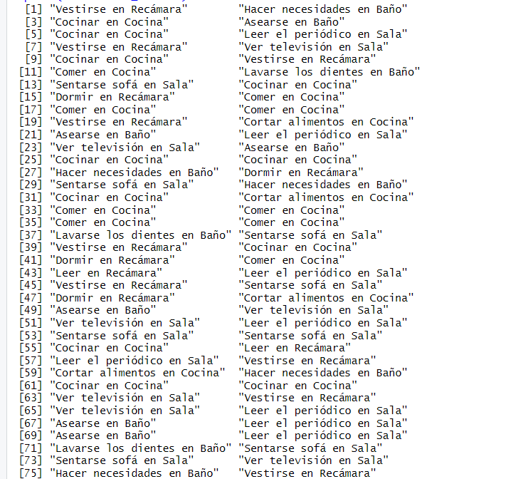
<figcaption>Simulacion de actividades</figcaption>
</figure>
<figure id="fig:hmmActividades">
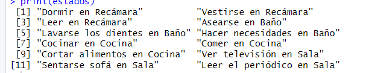
<figcaption>Actividades</figcaption>
</figure>
<figure id="fig:HMMhabitaciones">
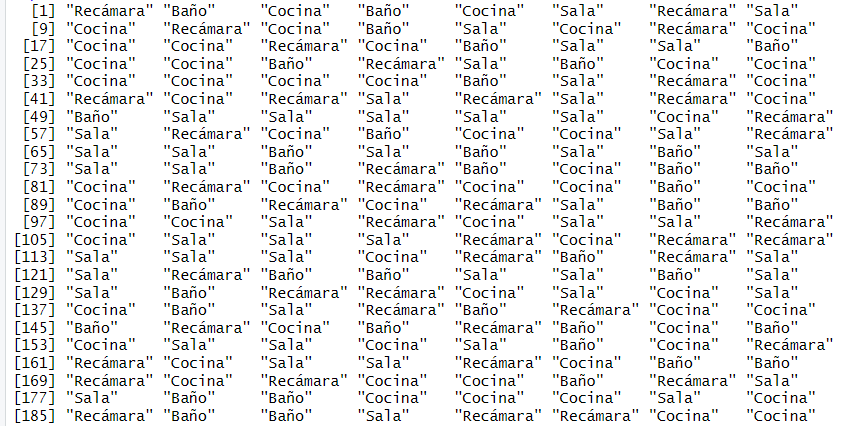
<figcaption>Habitaciones observadas por le resultado HMM
simulado</figcaption>
</figure>
<figure id="fig:viterbi">
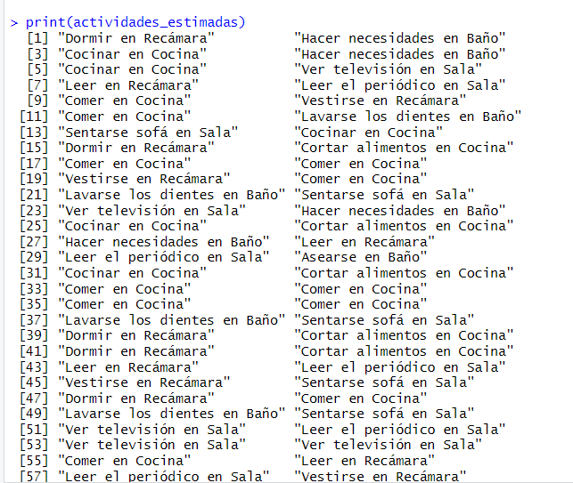
<figcaption>Actividades estimadas por el algoritmo de
viterbi</figcaption>
</figure>
<figcaption>Habitaciones simuladas durante el día</figcaption>
</figure>

Ambas metodologías son validas, tanto usar el método por simulación o el
método determinista dado la probabilidad de los estados y poder inferir
cuales son los estados más probables de transicionar. Sin embargo, para
el siguiente paso, es más práctico utilizar el primer método, debido a
que se necesita hacer diversas muestras y montecarlo se basa en muchas
muestras o experimentos.

# etapa 5

``` {#lst:etapa5 .r language="R" caption="Etapa 2" label="lst:etapa5"}
montecarlo <- function(simulaciones, T = 24, estados, habitaciones) {
  resultados <- list()
  
  tiempos_habitaciones <- matrix(0, nrow = simulaciones, ncol = length(habitaciones))
  colnames(tiempos_habitaciones) <- habitaciones
  
  visitas_hora <- matrix(0, nrow = simulaciones, ncol = T)
  colnames(visitas_hora) <- paste0("Hora_", 1:T)
  
  estados_hora <- matrix(0, nrow = simulaciones, ncol = T)
  colnames(estados_hora) <- paste0("Hora_", 1:T)
  
  actividades <- matrix(0, nrow = simulaciones, ncol = length(estados))
  colnames(actividades) <- estados
  
  A <- matriz_transicion(length(estados),288)
  B<-crear_matriz_emision(estados, habitaciones)
  pi <- crear_pi_inicial(length(estados))
  for (i in 1:simulaciones) {
    
    sim <- simular_HMM(T, A, B, pi)
    obs <- habitaciones[sim$observaciones]
    est <- estados[sim$estados_ocultos]
    
    tabla_h <- table(factor(obs, levels = habitaciones))
    tiempos_habitaciones[i, ] <- as.numeric(tabla_h)
    
    visitas_hora[i, ] <- sim$observaciones
    estados_hora[i, ] <- sim$estados_ocultos
    
    tabla_a <- table(factor(est, levels = estados))
    actividades[i, ] <- as.numeric(tabla_a)
  }
  
  resultados$tiempos_por_habitacion <- tiempos_habitaciones
  resultados$visitas_por_hora <- visitas_hora
  resultados$estados_por_hora <- estados_hora
  resultados$actividades_totales <- actividades
  return(resultados)
}
```

En la etapa 5 tenemos que simular para varios días y encontrar el
conjunto de actividades que realizar el señor por franja de hora. La
función de montecarlo necesitará una cantidad de simulaciones, las
franjas de horas, el vector de estados y el vector de habitaciones. Se
genera una lista vacía. Después se generan la matriz de tiempo en
habitaciones, que indicará las habitaciones en las que estará el señor
por franja de hora, el número de visitas por hora, los estados por
hora,(actividades por habitación) y las actividades por hora. Se genera
la matriz de transición A, la de emisión B y el vector de probabilidad
uniforme pi. Se generaran las simulaciones, y en cada una simula el HMM,
subsecuentemente extrae las observaciones y estados para esa simulación.
Genera un vector de frecuencias de las observaciones, por ejemplo,
¿cuántas veces entro al baño? y este vector lo guardará en
tiempos_habitaciones por renglón. A su vez que se guardan las
observaciones en visitados y en estados por hora se guarda el vector de
estados. En actividades guardamos las frecuencias con la que los estados
ocurren Cada una de las matrices inicializadas se guardarán en la lista
y se devuelve la lista

Sin embargo, podemos gráficar los resultados con las siguientes
funciones

``` {#lst:etapa5B .r language="R" caption="Etapa 2" label="lst:etapa5B"}
    
resultados <-montecarlo(
  simulaciones =2000,
  T = 24,
  estados = estados,
  habitaciones = habitaciones
)

plot_rutas <- function(resultados, habitaciones) {
  
  n_show <- min(5, nrow(resultados$visitas_por_hora))
  sample_sims <- sample(1:nrow(resultados$visitas_por_hora), n_show)
  

  par(mar = c(5, 4, 4, 8), xpd = TRUE)
  plot(1, type = "n", xlim = c(1, 24), ylim = c(0.5, length(habitaciones)+0.5), 
       xlab = "Hora del día", ylab = "", yaxt = "n",
       main = "Variabilidad de rutas entre simulaciones")
  axis(2, at = 1:length(habitaciones), labels = habitaciones, las = 1)
  

  colores <- rainbow(n_show, alpha = 0.6)
  

  for (i in 1:n_show) {
    idx <- sample_sims[i]
    lines(1:24, resultados$visitas_por_hora[idx,], 
          type = "o", pch = 16, cex = 0.7, 
          col = colores[i], lwd = 1.5)
  }
  
  legend("topright", inset = c(-0.2, 0), legend = paste("Sim", 1:n_show),
         col = colores, lty = 1, pch = 16, cex = 0.7, title = "Trayectorias")
}


plot_tiempos_por_habitacion <- function(resultados) {
  df <- as.data.frame(resultados$tiempos_por_habitacion)
  boxplot(df, las = 2, main = "Tiempos de permanencia por habitación",
          ylab = "Horas", col = "lightblue")
}


plot_visitas_por_hora <- function(resultados, habitaciones) {
  mat <- resultados$visitas_por_hora
  frec <- matrix(0, nrow = 24, ncol = length(habitaciones))
  
  for (h in 1:24) {
    frec[h, ] <- table(factor(mat[, h], levels = 1:length(habitaciones)))
  }
  
  frec <- frec / nrow(mat)  # Probabilidad por hora
  barplot(t(frec), beside = FALSE, col = rainbow(length(habitaciones)),
          legend.text = habitaciones, args.legend = list(x = "topright"),
          main = "Histograma de visitas por hora", xlab = "Hora", ylab = "Proporción")
}


plot_probabilidad_habitacion_por_hora <- function(resultados, habitaciones) {
  mat <- resultados$visitas_por_hora
  probs <- matrix(0, nrow = 24, ncol = length(habitaciones))
  
  for (h in 1:24) {
    for (i in 1:length(habitaciones)) {
      probs[h, i] <- mean(mat[, h] == i)
    }
  }
  
  matplot(probs, type = "l", lty = 1, col = 1:length(habitaciones),
          xlab = "Hora", ylab = "Probabilidad",
          main = "Probabilidad de estar en habitación por hora")
  legend("topright", legend = habitaciones, col = 1:length(habitaciones), lty = 1)
}


plot_actividad_mas_probable <- function(resultados, estados) {
  est_por_hora <- resultados$visitas_por_hora
  actividad_hora <- character(24)
  
  for (h in 1:24) {
    actividades <- estados[est_por_hora[, h]]
    actividad_hora[h] <- names(sort(table(actividades), decreasing = TRUE))[1]
  }
  
  plot(1:24, type = "n", ylim = c(0, 1), yaxt = "n",
       xlab = "Hora", ylab = "", main = "Actividad más probable por hora")
  text(1:24, rep(0.5, 24), labels = actividad_hora, cex = 0.8)
  abline(h = 0.5, lty = 2)
}

plot_rutas(resultados,habitaciones)
plot_tiempos_por_habitacion(resultados)
plot_visitas_por_hora(resultados, habitaciones)
plot_probabilidad_habitacion_por_hora(resultados, habitaciones)
```

En el código de [\[lst:etapa5B\]](#lst:etapa5B){reference-type="ref"
reference="lst:etapa5B"}, se genera el resultado montecarlo, con 2000
simulaciones, 24 horas y con los estados y habitaciones. La primera
función de gráfica muestra como se ve desplazando el señor dado a una
habitación inicial hasta el final del día. La siguiente función muestra
la proporción de permanencia en una habitación. La función visitas por
hora muestra la proporción de las visitas en un hora con respecto a las
demás habitaciones, la función probabilidad habitación por hora, muestra
la probabilidad de estar en un segmento de tiempo dada la habitación

También está una ultima función que indica la rutina promedio del señor

``` {#lst:etapa5C .r language="R" caption="Etapa 2" label="lst:etapa5C"}
actividad_mas_probable_por_hora <- function(resultados, estados) {
  est_por_hora <- resultados$estados_por_hora
  cat("Actividad más probable por hora:\n")
  for (h in 1:24) {
    actividades <- estados[est_por_hora[, h]]
    freq <- table(actividades)
    freq_rel <- prop.table(freq)
    actividad_modal <- names(freq_rel)[which.max(freq_rel)]
    frecuencia_modal <- max(freq_rel)
    cat(sprintf("Hora %02d: %s (%.2f%%)\n", h, actividad_modal,frecuencia_modal))
  }
}

actividad_mas_probable_por_hora(resultados, estados)
```

En el código [\[lst:etapa5C\]](#lst:etapa5C){reference-type="ref"
reference="lst:etapa5C"} se muestra el como se extrae la rutina, primer
se necesita la lista de resultados y los estados posibles. Se recorrer
la horas y del vector estados, se extra un elemento est_por_hora es el
vector de los estados por hora dado la hora h. Se calculan las
frecuencias de las actividad, a su vez que su frecuencia relativa y
finalmente se encuentre la actividad con la frecuencia mayor y se
imprime esa actividad con esa frecuencia

# Análisis de resultados finales

A través de lo descrito en la sección 5, se extraen diversos recursos
que sirven de análisis para entender el comportamiento del señor dentro
de su hogar.

::: {#table:1}
   **Hora**  **Actividad**   **Ubicación**    **Porcentaje**
  ---------- --------------- --------------- ----------------
      01     Sentarse sofá   Sala                 0.09%
      02     Cocinar         Cocina               0.12%
      03     Asearse         Baño                 0.11%
      04     Cocinar         Cocina               0.11%
      05     Cocinar         Cocina               0.10%
      06     Cocinar         Cocina               0.12%
      07     Cocinar         Cocina               0.11%
      08     Cocinar         Cocina               0.12%
      09     Asearse         Baño                 0.11%
      10     Cocinar         Cocina               0.12%
      11     Cocinar         Cocina               0.12%
      12     Cocinar         Cocina               0.12%
      13     Asearse         Baño                 0.11%
      14     Cocinar         Cocina               0.12%
      15     Asearse         Baño                 0.12%
      16     Cocinar         Cocina               0.12%
      17     Cocinar         Cocina               0.12%
      18     Cocinar         Cocina               0.12%
      19     Cocinar         Cocina               0.12%
      20     Asearse         Baño                 0.12%
      21     Cocinar         Cocina               0.11%
      22     Cocinar         Cocina               0.12%
      23     Asearse         Baño                 0.11%
      24     Cocinar         Cocina               0.12%

  : Actividades por hora con su ubicación y porcentaje de ocurrencia
:::

Se observa en la tabla [1](#table:1){reference-type="ref"
reference="table:1"} la rutina completa del señor después de la
simulación y que extraemos la rutina por medio de la función descrita en
listing [\[lst:etapa5C\]](#lst:etapa5C){reference-type="ref"
reference="lst:etapa5C"}. El señor tiende a cocinar en varias ocasiones
del día y esto se explica dado a la matriz de transición en la que las
actividades de cocina tienden a tener una mayor probabilidad. Si se
reproduce el experimento y generamos otras matrices, podremos observar
diversas rutinas a la de la cocina.

Las figuras de

<figure id="fig:grid" data-latex-placement="h!">
<figure id="fig:variabilidad">
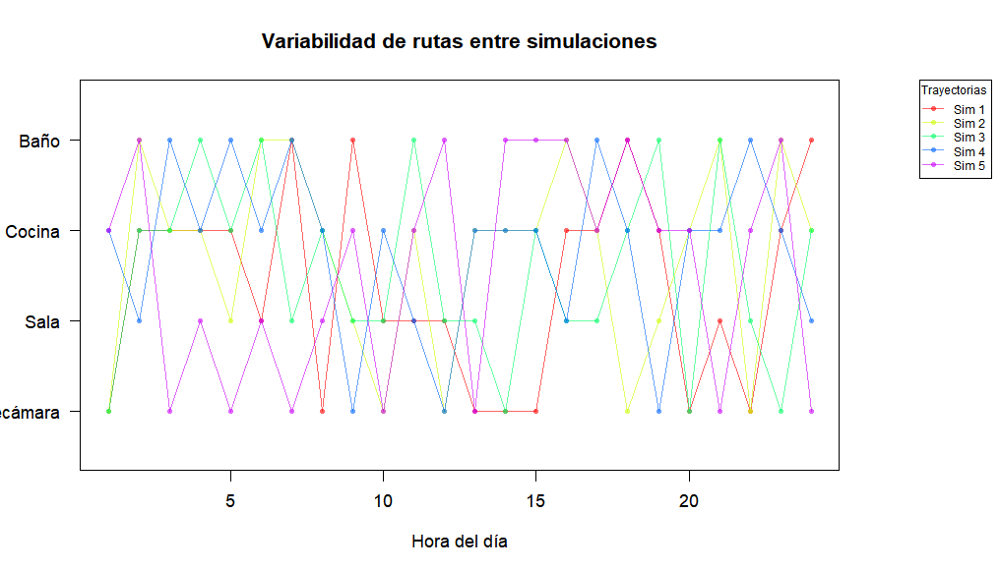
<figcaption>Desplazamiento por visualización</figcaption>
</figure>
<figure id="fig:tiempos">
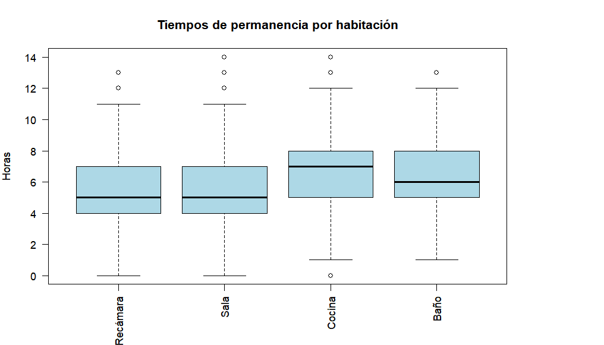
<figcaption>Tiempos de permanencia en habitaciones</figcaption>
</figure>
<figure id="fig:proporcion">
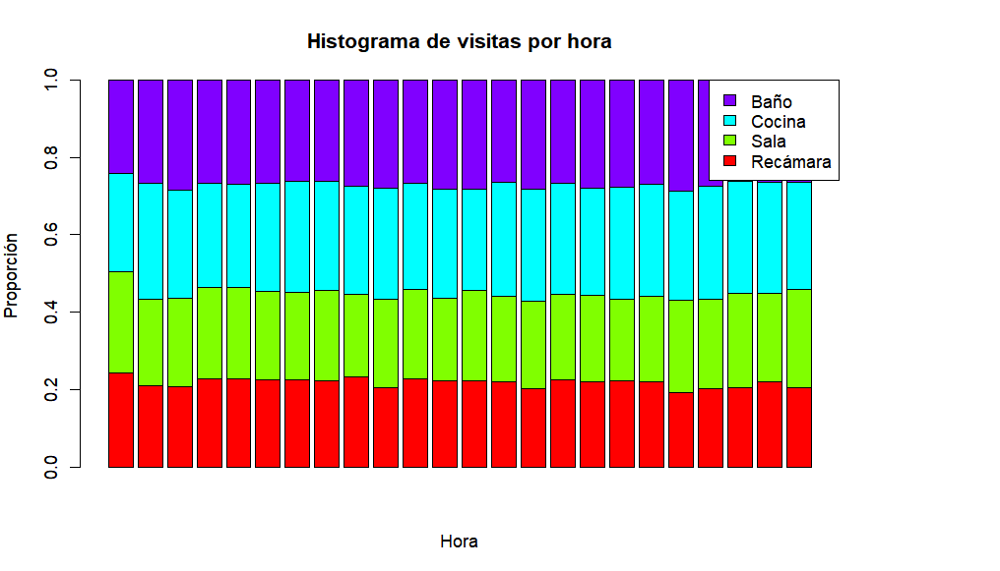
<figcaption>Proporción de estancia</figcaption>
</figure>
<figure id="fig:tasa">
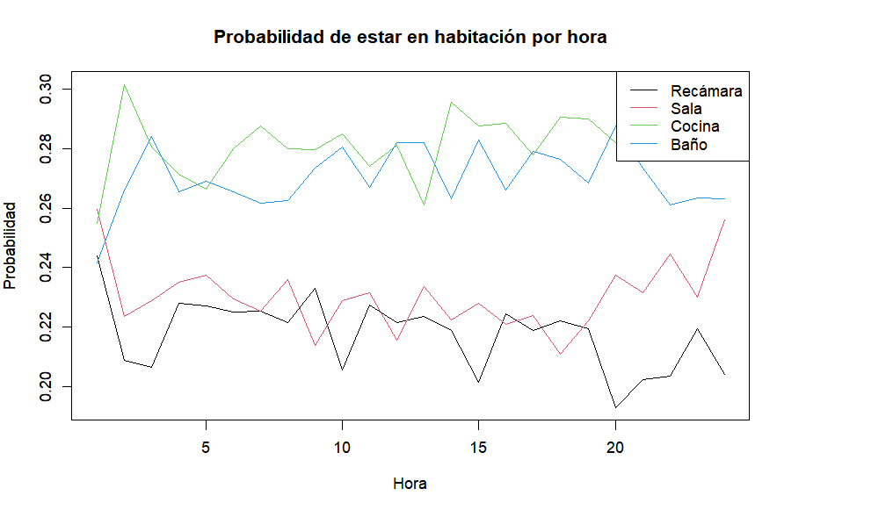
<figcaption>tasa de probabilidades</figcaption>
</figure>
<figcaption>Habitaciones simuladas durante el día</figcaption>
</figure>

En la figura [10](#fig:variabilidad){reference-type="ref"
reference="fig:variabilidad"}, se muestra como a partir de una
habitación el señor se desplaza de habitaciones hasta la última hora por
medio de 5 simulaciones. La figura
[11](#fig:tiempos){reference-type="ref" reference="fig:tiempos"} se
muestran los tiempos de permanencia por habitación y se observa que la
cocina es el lugar en el que el señor suele estar más,(seguido del
baño). Algo que podemos corroborar por su rutina, ya que la actividad
más probable es cocinar en la cocina. Figura
[12](#fig:proporcion){reference-type="ref" reference="fig:proporcion"},
muestra la proporción que se visita una habitación por hora. Se observa
que la cocina es uno de los lugares donde el señor sueles estar yendo
más seguido seguido del baño, sin embargo la figura
[13](#fig:tasa){reference-type="ref" reference="fig:tasa"} muestra con
mayor certeza la probabilidad en la que cada habitación es visitada, y
es más probable que el señor visite la cocina, sin embargo, hay momentos
del día, que sería después de comer, en los que está más en el baño.

## Aplicación en domótica

El gran problema de esto, es que los datos son irreales y muchas veces
no tendría sentido, por ejemplo, ¿El señor si duerme?, y es algo que el
modelo, a la hora de samplear no infiera debido a como se genera la
matriz de transición, sin embargo, la mejora forma de poder obtener esos
valores es por medio de sensores que indiquen su presencia en la
habitación. Podrían ser sensores detectores de objetos o cámaras que
identifiquen a la persona. Para el caso del registros de las
actividades, podría o ser un tablero que diga la actividad a realizar en
ese momento. Con esto se guardarían las veces que hace una actividad y
las veces que se visita un cuarto, (que sigue siendo un calculo similar
al como generamos la matriz de transición). la diferencia es que aquí
podremos tener más certera de que lo que hace es parte de su rutina
real. Este modelo podría implementarse en ese caso, si se contempla el
registro de frecuencias de habitación y actividades. En el artículo
[@gt2022], posee un estudio detallado de como aplico cadenas de markov
jerárquicas y con sensores en una hogar en el que registra los
desplazamientos del señor. A su vez, del uso de modelos de sensores y
cámaras.
